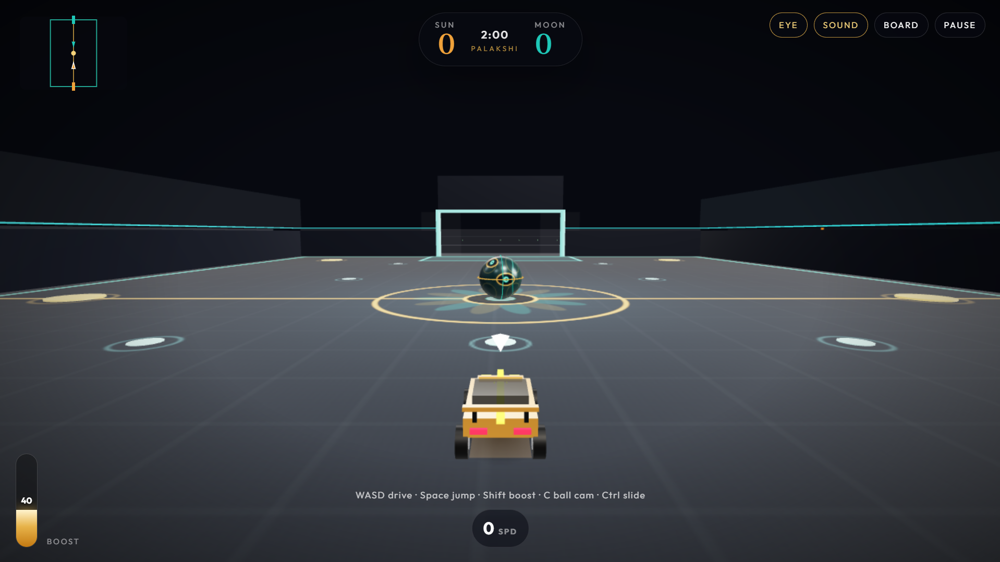
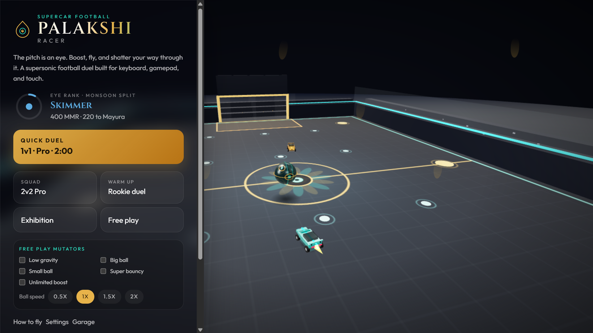
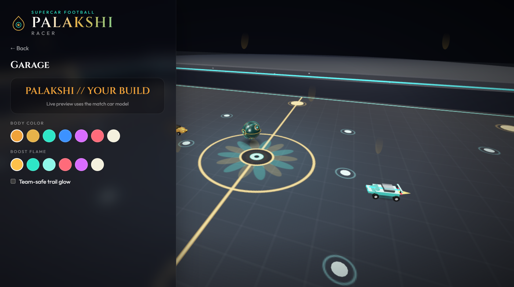

<div align="center">

# 🚀 Palakshi Racer

**Supersonic car football, right in your browser.**
One HTML file. No installs. Works offline.



<p>

&#x20; 

&#x20; 

</p></div>

\---

## ⚡ What is it?

Palakshi Racer is a fast, arcade-style game where you drive a rocket-powered car and knock a giant ball into the other team's goal. Boost across the arena, jump, flip, fly through the air, and smash opponents at supersonic speed.

Everything runs in a single `index.html` file. Download it once and play anywhere, even with no internet.

## 🎮 Play

**👉** [**atcontentmaker.github.io/palakshi-racer**](https://atcontentmaker.github.io/palakshi-racer/)

Or download `index.html` from this repo and open it in any modern browser.

## ✨ Features

|||
|-|-|
|🏟️ **Game modes**|1v1, 2v2, 3v3 with bot teammates, and free play|
|🤖 **Bot difficulty**|Rookie, Pro and Palakshi levels|
|🔥 **Boost \& pads**|Grab boost pads, burn boost, reach supersonic speed|
|✈️ **Aerials**|Double jump, tilt and boost through the air|
|💥 **Shatter**|Hit an opponent at supersonic speed to demolish them|
|🎬 **Goal replays**|Instant replays after every goal (skip with Enter)|
|🎨 **Garage**|Pick your car color, boost flame color and trail|
|🧪 **Free play mutators**|Low gravity, big or small ball, super bouncy ball, ball speed|
|📊 **Career stats**|Matches, wins, goals and top speed saved on your device|
|⏱️ **Overtime**|Sudden-death finishes when it's tied|
|📱 **Any device**|Keyboard, touch controls and gamepad support|

## 🕹️ Controls

|Action|Keyboard|
|-|-|
|Drive / steer|`W` `A` `S` `D` or arrow keys|
|Boost|`Shift`|
|Jump / double jump|`Space`|
|Slide|`Ctrl`|
|Ball cam|`C`|
|Scoreboard|`Tab`|
|Skip replay|`Enter`|
|Reset (free play)|`R`|
|Pop the ball (free play)|`B`|

📱 **Touch:** on-screen joystick and buttons appear on phones and tablets.
🎮 **Gamepad:** plug one in and use the left stick to steer.

## 🛠️ Built with

* [**Three.js**](https://threejs.org/) for 3D graphics
* [**React**](https://react.dev/) for menus and UI
* **Vite** for building, bundled into one file
* **Web Audio** for synthesized sounds (no audio files)

## 🧱 Build from source

The Vite project lives in [`source/`](source/).

```bash
cd source
npm install
npm run build
```

The build output goes to `source/dist/`. Copy `source/dist/index.html` to the repo root to update the playable game.

## 🗺️ Roadmap

* \[ ] Training drills (shooting, saves, aerials)
* \[ ] Tournament / career mode
* \[ ] Local split-screen for two players

## 🤝 Contributing

Found a bug or have an idea? [Open an issue](../../issues) and tell me what happened. Pull requests are welcome.

## 📄 License

Released under the [MIT License](LICENSE).

\---

<div align="center">

Made with ❤️ by **AT** · If you like it, drop a ⭐

</div>

